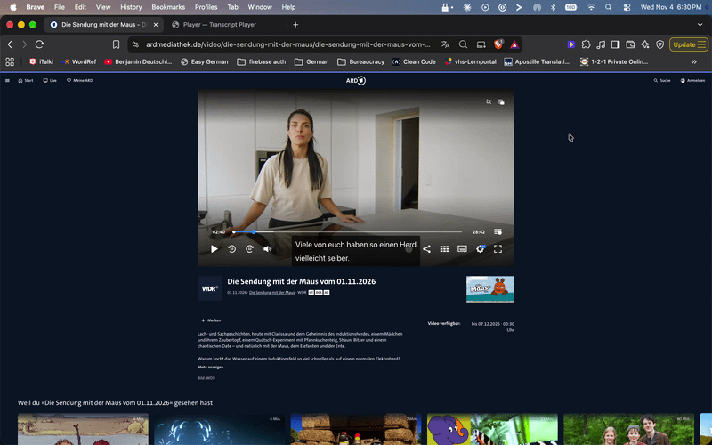
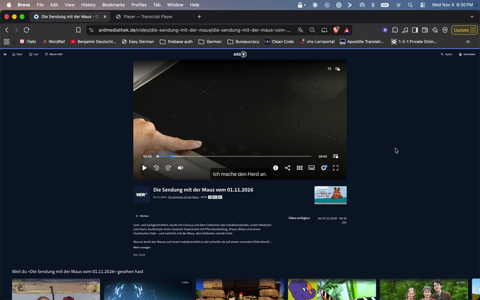
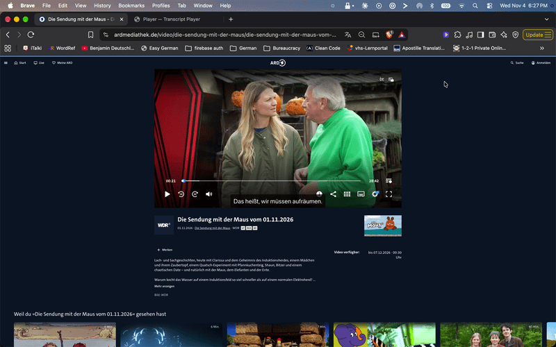

# ARD Subtitle Translator

Chrome extension that overlays clickable German subtitles (with English translations) over ARD Mediathek videos.

**One click on any ARD video page** — the extension auto-detects the subtitle file, translates it via LLM, and overlays it on the page you're already watching. No manual file drop, no URL pasting, no reload.

Both German and English subtitles appear simultaneously. Click any word for a contextual gloss popup. Use the 🇩🇪/🇬🇧 toggles in the popup to show or hide each language.

## Demo

**Both languages overlaid on the video:**



**Click any word for a contextual gloss:**



**Hover to reveal a hidden language:**



## How it works

### Streamlined import (primary)

1. **Click the extension icon** on any `ardmediathek.de/video/...` page → popup shows "Translate This Video".
2. **Click the button** — the extension auto-enables subtitles (CC) to load subtitle metadata, finds the subtitle URL (from the page data blob, or by scanning the performance resource buffer as a fallback), fetches the XML under the page's own origin (CORS-safe), runs the translation pipeline, then turns CC back off (so ARD's native subtitles don't overlap with the overlay).
3. **Overlay appears automatically** on the page you're already on — no tab switch, no reload, video keeps playing.

### Manual import (fallback)

On non-ARD pages, the popup shows "Open Translator" — this opens the import tab where you can drop a subtitle XML file and paste a video URL manually.

## Tech stack

- Plain JavaScript (no framework, no build step, no TypeScript)
- UMD module pattern (works in both browser `<script>` and Node `require()` for tests)
- Chrome Manifest V3
- OpenRouter API (`openai/gpt-4o-mini`)
- Node `--test` runner + `node:assert`

## Project structure

```
src/
  parser/parser.js         TTML (EBU-TT-D) parser → {start, end, text} cues
  services/prompt.js       System prompt, numbered-list builder, response parser
  services/api.js          OpenRouter fetch with exponential backoff
  services/translate.js    Batch orchestrator (split/retry/concurrency)
  services/validate.js     Stub (logic merged into prompt.js)
  services/tokenize.js     Word tokenizer for clickable spans & gloss indices
  services/gloss.js        Word-level gloss LLM prompt & response parser
  storage/storage.js       chrome.storage.local wrapper (cues, gloss cache, API key)
  background/background.js Service worker — gloss LLM calls + streamlined-import orchestrator
  popup/                   Context-aware launcher ("Translate This Video" on ARD, import tab fallback)
  import/                  Full-tab translation UI (manual fallback)
  options/                 API key settings page
  content/content.js       Video overlay (sync, render, click, hover, gloss popup)
  content/discover.js      Subtitle URL extraction + fetch + parse (triggered by background)
test/                      69 tests across 5 suites
  fixtures/
    ard-sample.ttml         Trimmed ARD fixture
    zdf-sample.ttml         Trimmed ZDF fixture
```

## Setup

```bash
# Install dev dependency (only needed for tests)
npm install
```

### Load the extension

1. Open `brave://extensions` (or `chrome://extensions`)
2. Enable **Developer mode**
3. Click **Load unpacked** → select the project directory
4. Click the extension icon → ⚙️ Settings → paste your OpenRouter API key → Save

### Translate subtitles

**Streamlined (primary):** go to any ARD video page, click the extension icon → **Translate This Video**. Progress shows on the badge, overlay auto-injects when done.

**Manual (fallback):** on any non-ARD page, click the extension icon → **Open Translator** → drop a subtitle XML → paste the video URL → click Translate.

### Watch

1. Go to the video page in ARD Mediathek
2. German + English subtitles appear simultaneously at the bottom, synced to the video
3. **Click** any word to see a gloss popup (lemma + contextual meaning, ~1–3s first click, instant afterwards)
4. Open the popup anytime to toggle 🇩🇪 Original or 🇬🇧 English on/off

## Tests

```bash
npm test   # 69 tests, zero dependencies beyond @xmldom/xmldom
```

## Configuration

| Key | Default | Where |
|-----|---------|-------|
| Model | `openai/gpt-4o-mini` | `SubtitleServices.config.MODEL` in `src/services/translate.js` |
| Batch size | 20 | `S.config.BATCH_SIZE` |
| Concurrency | 3 | `S.config.CONCURRENCY` |
| Show German | `true` | Popup toggle → `display_german` in `chrome.storage.local` |
| Show English | `true` | Popup toggle → `display_english` in `chrome.storage.local` |

## API key

Stored in `chrome.storage.local` under key `openrouter_api_key`. Set via the options page, never committed.
